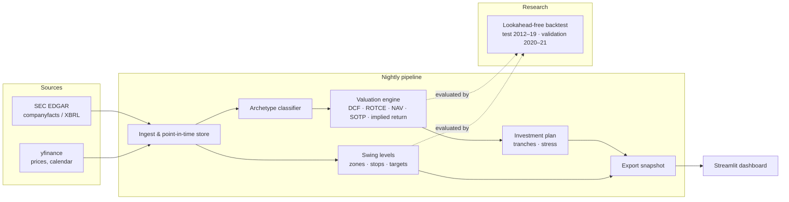

# Swing System — autonomous equity scanner, valuation engine & swing-trade planner

A decision-support system that scans a universe of **~1,050 US and German stocks every trading day**, classifies each company by business type, values it with the model that fits that type, detects swing setups from support/resistance zones, and condenses everything into one clear page per stock — so that a non-expert can understand the case and the chart at a glance.

> Decision support only. The system never places trades; every decision stays with the user.


## What it does

| Area | What happens |
|---|---|
| **Daily scan** | After the close, prices, filings and calendars are refreshed and the whole pool (S&P 500/400, Nasdaq-100, DAX + watchlist) is re-analysed. |
| **Business-type classification** | Each company is assigned one of ~12 archetypes (quality compounder, bank, insurer, REIT, utility, cyclical, hyper-growth, capacity build-out, turnaround, conglomerate, defence, ...) using rules on SEC filings — no ML, no per-ticker tuning. |
| **Valuation per archetype** | FCFF-DCF for operating companies, ROTCE/excess-return models for banks & insurers, NAV for REITs, sum-of-the-parts for conglomerates, and an **implied-return** view for capital-intensive build-outs (e.g. neoclouds) where a point fair value would be meaningless. Ranges are methodically bounded; if a model doesn't fit, the UI says *"not reliable"* and shows why instead of an absurd number. |
| **Swing setups** | Support/resistance zones from swing pivots and moving averages; entry zone, stop, knock-out level for leveraged products, targets and net reward/risk after financing costs. |
| **Evidence-based stops** | Stop rules were tested on ~37,000 historical setups (see below) instead of being set by feel. |
| **Investment plans** | Tranche plan with buy levels, volatility-aware thesis stop and ordered stress scenarios. |
| **Dashboard** | Live market panel (incl. pre-/post-market), earnings calendar with full company names, interactive locked charts (TradingView Lightweight Charts). |

## Architecture



## Evidence: swing stops

Historical setups generated with the unchanged live function on price history truncated at each date (test 2016–19: 24,108 setups, validation 2020–21: 12,966; 2023+ sealed).

| Rule | Hit rate (target 1) | Expectancy per unit risk |
|---|---|---|
| Live rule (1 ATR below zone, KO 1 ATR below stop) | 66 % | 0.25 R |
| 2 ATR | 71 % | 0.22 R |
| 3 ATR | 77 % | 0.17 R |

Wider stops raise the hit rate but lower the expectancy and the achievable leverage, consistently in every year 2016–2021 and every volatility bucket. For **long-term investment** plans the opposite was true: the old stop triggered in 41–50 % of cases without the thesis breaking; a volatility-bucket stop cut this to 6 % in validation. Details: [docs/research/STOP_EVIDENCE.md](docs/research/STOP_EVIDENCE.md) (German).

## Honest results & known weaknesses

- On average the fair value sits at **~0.80× price** (training) / **0.84×** (validation) vs. a target band of 0.85–1.15 — the engine is deliberately conservative (reported figures only, mean-reverting margins).
- About a third of the universe is flagged *"not reliable"*, most of them cyclicals.
- In the backtest, the current engine does **not** beat the earlier version or a simple FCF-yield ranking. It is a transparent valuation tool, not a proven alpha source.
- Known outliers are documented and handled with general rules only (no per-ticker fitting).

## Screenshots

| Swing chart (daily detail) | Valuation |
|---|---|
|  |  |
| **Investment tranche plan** | **Stress scenario** |
|  |  |

## Repository layout

```
app/          Streamlit dashboard (pages, styling, live quotes, charts)
valuation/    Valuation engine: archetypes, DCF, capital costs, SOTP, investment plan, EDGAR fetch
swing/        Swing levels, stop/target logic, chart, stop-evidence display
backtest/     Valuation backtests, diagnostics, stop/exit studies (backtest/studies)
scripts/      Export / sync jobs that build the data snapshot
tests/        Unit tests and Playwright click tests
docs/         Methodology, research notes, screenshots
```

## Tech stack

Python 3.12 · pandas / NumPy / PyArrow · DuckDB · Streamlit · Plotly · TradingView Lightweight Charts · Playwright (UI tests) · SEC EDGAR XBRL · yfinance

## How to run

```bash
python -m venv .venv && source .venv/bin/activate
pip install -r requirements.txt
export DEMO_PASSWORD=choose-one
export SEC_USER_AGENT="Your Name your@email.com"   # required by SEC EDGAR
export MARKET_STORE=/path/to/your/data_store
./run.sh
```

**Data is not included** for licensing reasons (price and fundamental data may not be redistributed). Fundamentals are fetched from SEC EDGAR (`valuation/edgar_fetch.py`), prices and calendars via yfinance; the scripts in `scripts/` build the `data/` snapshot the app reads. No API keys are stored in this repository — any optional provider key must be supplied via environment variable.

## License

MIT © Lennart Merschel
