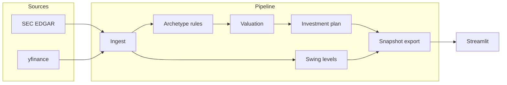

# Swing System

Decision-support code for a universe of US and German stocks: classify the business, value it with a documented rule set, and show a swing plan. The program does not place trades. Every decision stays with the reader.

Lennart Merschel (Data and Information Science, TH Köln) set the concept, the requirements, and the review. Coding assistants did a large part of the implementation. This repository does not claim that one person typed every line, and it does not claim a tested trading edge.

## This repository and the private demo

This tree is the public portfolio (MIT), last aligned with the code published here. It holds:

- `app/` Streamlit pages
- `valuation/` rule-based valuation
- `swing/` levels, stops, and the chart
- `backtest/` and `backtest/studies/` historical studies
- `scripts/` jobs that build a local snapshot
- `tests/` unit tests and Playwright click tests
- `docs/` methodology and study notes

The private review build, called fv18, is a later local copy. Its source and its data snapshot are not in this repository, and this repository is not a place to upload them. No site is deployed from here. Hosting, if it happens, needs a separate decision and a separate private location. Do not point Streamlit Community Cloud at this public tree and expect the fv18 demo.

Market prices and fundamentals are absent on purpose. Several series cannot be redistributed. `./run.sh` starts Streamlit, and without a local `data/` snapshot the pages do not form a complete demo.

## What the public code contains

| Area | In this repository |
|---|---|
| Snapshot jobs | `scripts/` refreshes prices, filings, and calendars into a local store. No scheduler is committed, so "daily" describes the intended job, not a process this repo runs. |
| Classification and valuation | Archetype rules, then a model for that type (FCFF-DCF, excess return, NAV, sum-of-the-parts, implied return where a single fair value does not fit). Unusable cases are labeled not reliable. |
| Swing plan | Zones from pivots and moving averages, entry, stop, targets, and reward/risk after financing cost. |
| Stops | The live stop rule was measured on historical setups. Write-up: [docs/research/STOP_EVIDENCE.md](docs/research/STOP_EVIDENCE.md). |
| Investment plan | Tranches, a volatility-bucket thesis stop, and ordered stress cases. |
| Dashboard | Streamlit UI, including a market strip, calendars, and charts. TradingView Lightweight Charts is vendored under `app/vendor/` (Apache-2.0). |



Methodology: [docs/methodology.md](docs/methodology.md). Valuation notes: [docs/research/VALUATION_V4.md](docs/research/VALUATION_V4.md).

## Study results already written up here

These figures are historical measurements inside this repository. They are not a live track record and not a forecast.

Setups were built with the unchanged live function on price history cut at each date (test 2016–19: 24,108 setups, validation 2020–21: 12,966; 2023+ sealed). From [docs/research/STOP_EVIDENCE.md](docs/research/STOP_EVIDENCE.md):

| Rule | Hit rate, target 1 | Expectancy per unit risk |
|---|---|---|
| Live rule (1 ATR below the zone, knock-out 1 ATR below the stop) | 66% | 0.25 R |
| 2 ATR | 71% | 0.22 R |
| 3 ATR | 77% | 0.17 R |

Wider stops raised the hit rate and lowered the expectancy, in each year 2016–2021 and in each volatility bucket. On long-term plans the older stop fired in 41–50% of cases without the thesis breaking; a volatility-bucket stop cut that to 6% in validation.

On the valuation backtest, average fair value sat near 0.80× price in training and 0.84× in validation, against a stated band of 0.85–1.15. About a third of names were flagged not reliable, many of them cyclicals. In that backtest the engine did not beat the earlier version or a simple FCF-yield ranking.

## Screenshots

None are in the tree. The old `docs/screenshots/*.png` links pointed at files that were never committed: `.gitignore` ignored every `screenshots/` directory, including `docs/screenshots/`. Those links are removed. Reviewed captures can be added later under `docs/screenshots/`. Generated click-test output stays in the top-level `screenshots/` directory, which is still ignored.

## Tests

GitHub Actions (`.github/workflows/tests.yml`) runs, on Python 3.12:

- `tests/test_valuation_v2.py`
- `tests/test_valuation_v3.py`, excluding the two tests whose names contain `erp`

On a clean checkout that is 14 passed, 3 skipped, 2 deselected. The skips are `test_terminal_g_never_above_rf_in_export`, `test_output_file`, and `test_earnings_basis_consistent`: they look for `data/valuation_v2.json`, `data/valuation_v3.json`, and `data/earnings_v3.json`, which are not shipped. The two ERP tests read `valuation/data/damodaran_erp_monthly.csv`. That CSV is not in the repository (`*.csv` is gitignored), and those tests fail with `FileNotFoundError` if they are included. They are not in CI.

Not in CI, because they need a populated snapshot and, for the browser tests, a running app plus Playwright:

- `tests/test_v4_price_invariance.py` (a script, not a pytest module; it also imports `scripts/export_valuation_v4.py` and a cache)
- `tests/clicktest.py`, `tests/clicktest_analyse.py`, `tests/clicktest_invest.py`

There is no status badge. A badge would claim a GitHub run that this repository has not recorded yet. `requirements.txt` installed on Linux with Python 3.12 in review (`streamlit==1.66.0` and the pins beside it). Playwright and DuckDB are not in that file. DuckDB is imported by `scripts/export_market_hist.py`. Playwright is imported only by the click tests.

## How to run the public app

```bash
python -m venv .venv && source .venv/bin/activate
pip install -r requirements.txt
export DEMO_PASSWORD=choose-one
export SEC_USER_AGENT="Your Name your@email.com"   # SEC EDGAR fair-access header, when a script fetches
export MARKET_STORE=/path/to/your/data_store
./run.sh
```

`run.sh` sets `PYTHONPATH` and starts `app/app.py`. It refuses to start if `DEMO_PASSWORD` is empty. It does not create the data snapshot. No API key is stored in the tree. Optional provider keys belong in the environment.

## License

MIT © Lennart Merschel. See [LICENSE](LICENSE).
